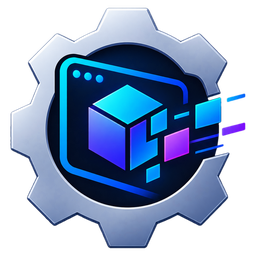
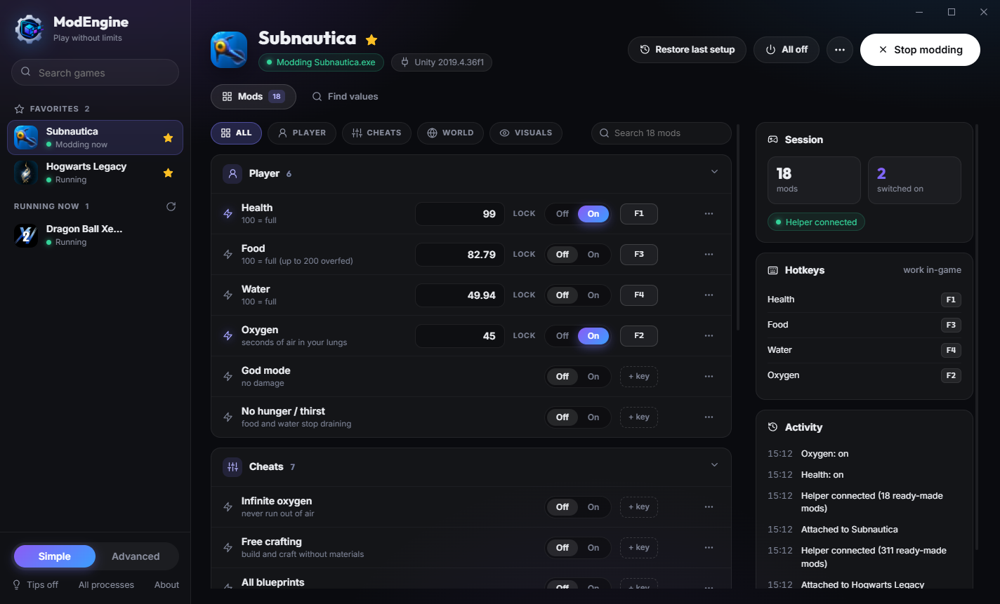
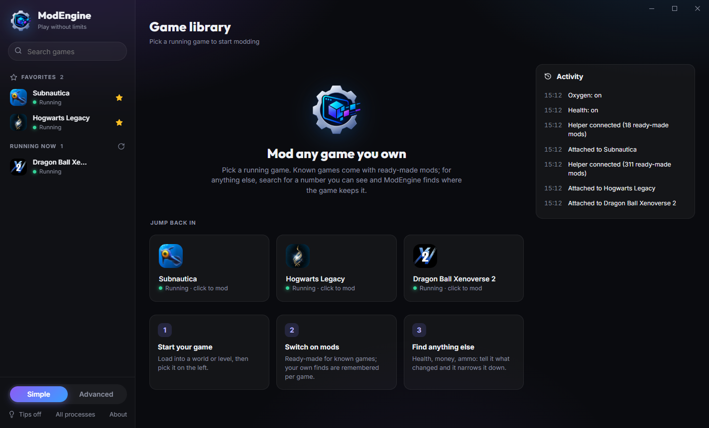
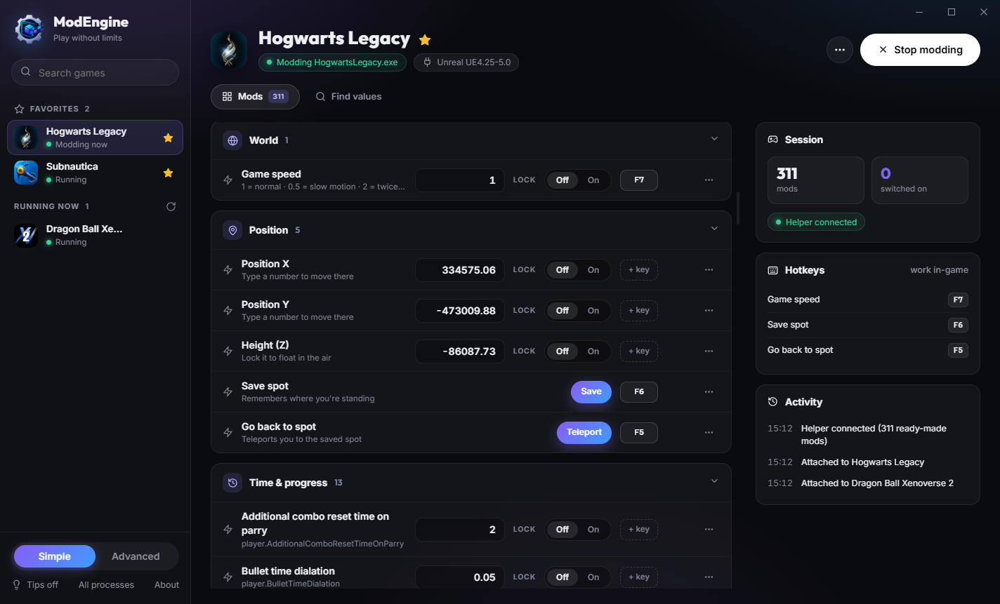
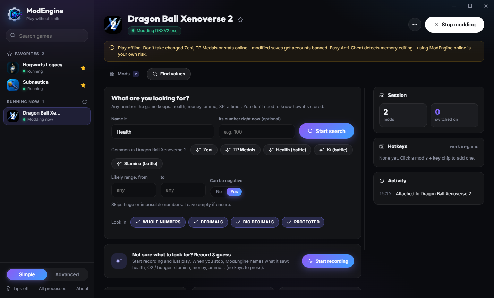
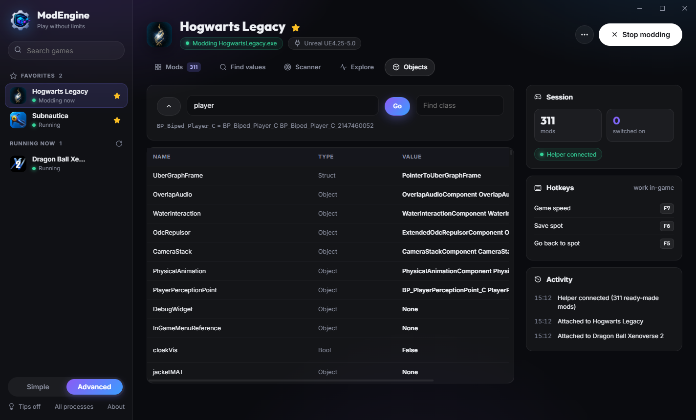
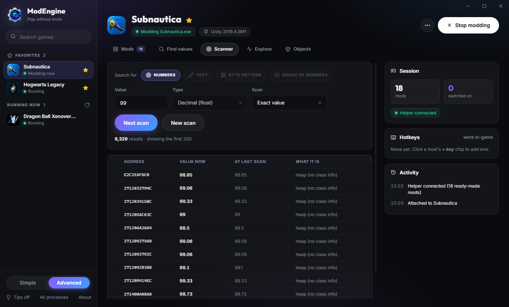
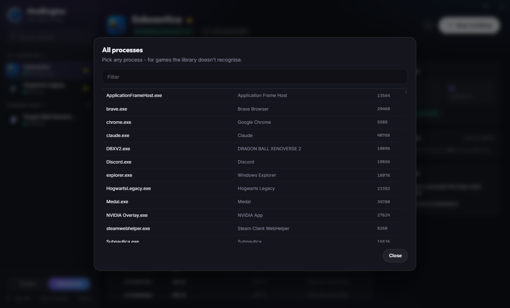

# ModEngine

**Play without limits.** Mod the single-player games you own: infinite health, money, slow motion, teleport,
inventory counts. Pick your game, switch mods on, play.

&nbsp;

&nbsp;

> [!IMPORTANT]
> **For single-player and offline play.** ModEngine is a tool: what you use it on, and what happens because of
> it, is your choice and your responsibility. It has no way to hide from anti-cheat, and games ban accounts for
> modified values online. **Back up your saves before modding.** See the [Terms of Use](legal/TERMS.md).

## ✨ What it does

| | |
|---|---|
| 🎮 **Game library** | Your running games with their real icons, favorites, and every game you've modded before. |
| ⚡ **Ready-made mods** | Supported games and whole engines come with mods sorted into categories - Battle, Money & items, Inventory, Position... |
| 🔒 **Locks & hotkeys** | Lock any value so it never drops, and give any mod a hotkey that works inside the game. |
| 🔎 **Find any value** | Type the number you see, change it in the game, tell ModEngine what happened - it narrows it down for you. |
| 🎙️ **Record & guess** | Not sure what to look for? Just play while it records, and it suggests health, stamina, money and ammo. |
| 🌀 **Game speed & teleport** | Slow motion or fast-forward, move anywhere, save a spot and jump back to it. |
| 🗂️ **Groups** | Change several values at once - all four health bars in one go. |
| 🛠️ **Advanced mode** | A full scanner (numbers, text, byte patterns, groups), Explore, and an object browser - and it works with any process. |
| 🔐 **Private** | No account, no ads, no telemetry. Nothing is ever sent over the internet. |
| ♿ **Accessible** | Full keyboard control, screen-reader labels, zoom, reduced motion, WCAG AA contrast. |

## 🧩 Supported engines

| Engine | How | Ready-made |
|---|---|---|
| **Unreal Engine 4.25+ / UE5** | Reads the game's own class data - nothing is injected | Your character's values, game speed, position & teleport, inventory |
| **Godot 3 & 4** | One line in the game's `override.cfg` (removed when you forget the game) | Player and game values, game speed, position & teleport, inventory |
| **Unity (Mono)** | Small in-game helper | Values by name, game-specific mods |
| **Ren'Py** | Small in-game helper | Every story variable, sorted: stats, relationships, money, battle... |
| **Java** | Small in-game helper | Values by name |
| **Any other game** | Memory search | Whatever you find - remembered per game |

## 📸 Screenshots

<table>
<tr>
<td width="50%"> <b>Game library</b> - your running games with their real icons and favorites</td>
<td width="50%"> <b>Hogwarts Legacy (Unreal)</b> - game speed, position, save a spot and teleport back with a hotkey</td>
</tr>
<tr>
<td width="50%"> <b>Find values</b> - guided search with game-specific suggestions, or let Record & guess do it</td>
<td width="50%"> <b>Objects (Advanced)</b> - browse the game's own objects and add any value as a mod</td>
</tr>
<tr>
<td width="50%"> <b>Scanner (Advanced)</b> - numbers, text, byte patterns and groups, like a classic memory scanner</td>
<td width="50%"> <b>Any process</b> - not just games in the library: pick any running program</td>
</tr>
</table>

Shown: Subnautica, Hogwarts Legacy and Dragon Ball Xenoverse 2, played offline. Game names, icons and trademarks belong to their owners; ModEngine is not affiliated with them.

## 🚀 Get started

1. **[Download the latest release](../../releases/latest)** - `ModEngine-1.0.0-Portable.zip`.
2. **Unzip it and run `ModEngine-Portable.exe`.** No installation, nothing else to install.
3. **Read and accept the terms** (first start only).
4. **Start your game** and load into a world or level.
5. **Click your game** in ModEngine's library, then switch mods on - or open **Find values** to find your own.

> [!TIP]
> Unity, Ren'Py, Java and Godot games show a **Connect** button on the Mods page the first time - click it and
> their ready-made mods appear. After that, ModEngine connects by itself when you pick the game. Godot games need
> one restart after the first Connect.

## ❓ FAQ

<b>Windows says "Windows protected your PC"</b>

That's SmartScreen being careful with a new download. Click **More info → Run anyway**. You can confirm your file is
the original by comparing its SHA-256 checksum with `SHA256SUMS.txt` on the release page
(PowerShell: `Get-FileHash .\ModEngine-Portable.exe`).

<b>My antivirus flags it</b>

Every memory editor reads and writes other programs' memory - that's exactly what antivirus tools watch for, so
false alarms happen. ModEngine only touches the games you pick. Download it only from this page.

<b>Can I use it in online or multiplayer games?</b>

It isn't made for that and the [Terms of Use](legal/TERMS.md) don't allow it. ModEngine has no way to hide from
anti-cheat; it warns you when it sees anti-cheat in a game, but what you do next - and any ban - is on you.

<b>"Access denied" when I pick a game</b>

Some games run with higher rights. Close ModEngine, right-click it → **Run as administrator**.

<b>Where are my mods saved? How do I remove everything?</b>

In `%USERPROFILE%\.modengine` on your PC. To forget one game: open it → **⋯ → Forget this game**. To remove
everything: quit ModEngine and delete that folder. See the [Privacy Policy](legal/PRIVACY.md).

<b>My game isn't in the library</b>

Click **All processes** at the bottom left and pick it there. Next time it'll be in **My games**.

## 🐞 Problems, ideas, accessibility

Open an [issue](../../issues) - tell us the game, what you tried and what happened. Accessibility problems are
welcome there too ([Accessibility Statement](legal/ACCESSIBILITY.md) · [הצהרת נגישות](legal/ACCESSIBILITY.md)).

## 📄 Legal

ModEngine is free to use under the [ModEngine License (EULA)](LICENSE) and the [Terms of Use](legal/TERMS.md).
[Privacy Policy](legal/PRIVACY.md) · [Accessibility Statement](legal/ACCESSIBILITY.md) ·
[Third-party notices](legal/THIRD_PARTY_NOTICES.md) · [What's new](legal/CHANGELOG.md)

ModEngine is provided **as is, without warranty**. It is an independent project, not affiliated with or endorsed by
any game publisher, developer, engine maker or platform. All game names and trademarks belong to their owners.

© 2026 ModEngine. All rights reserved.

